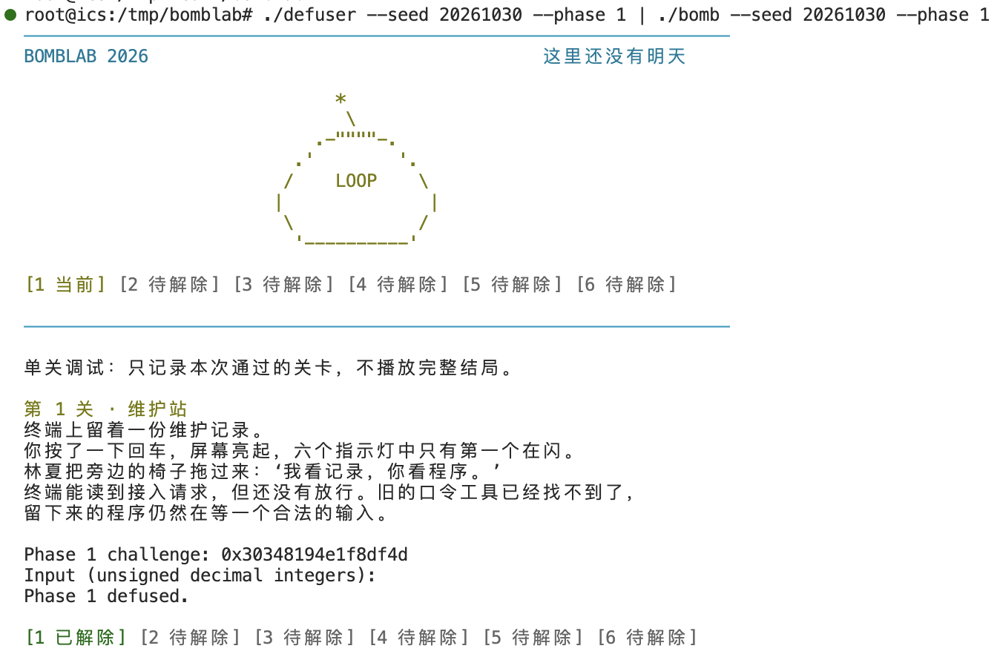
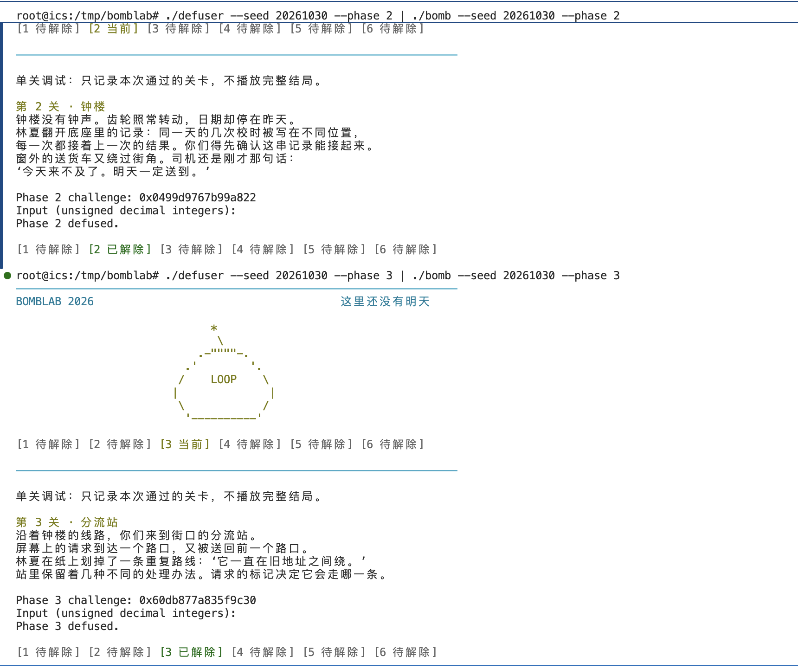
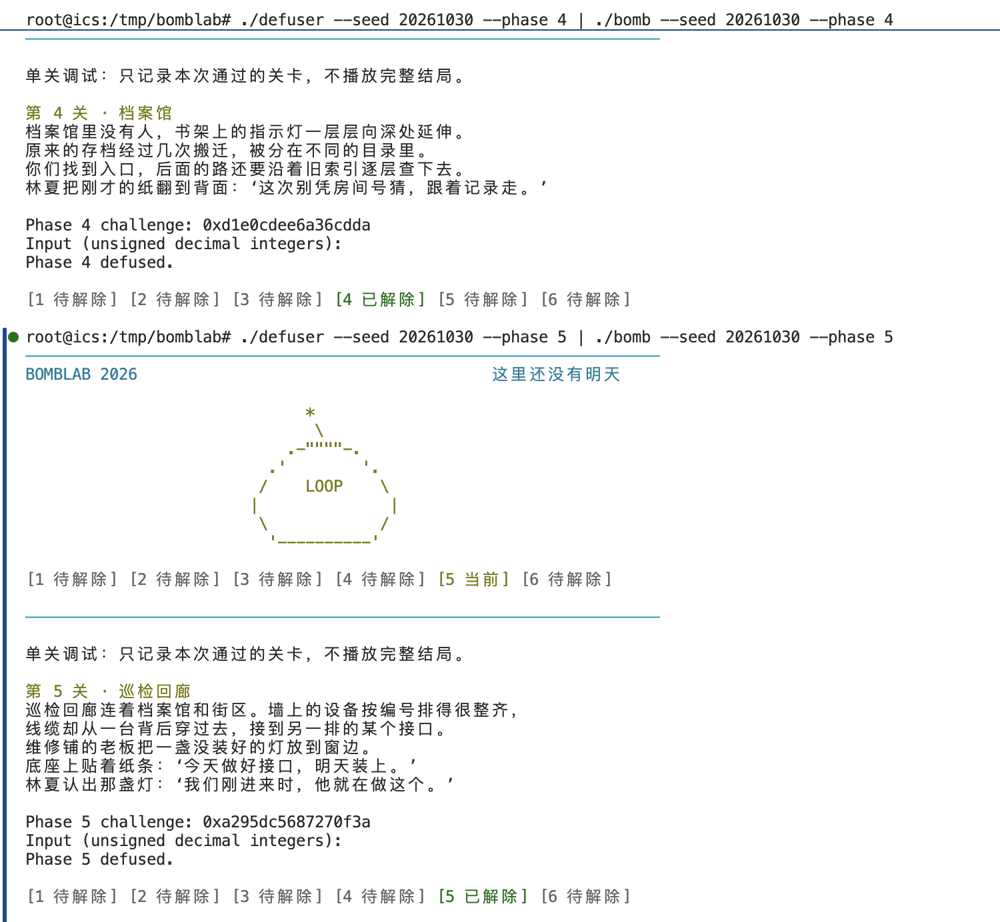
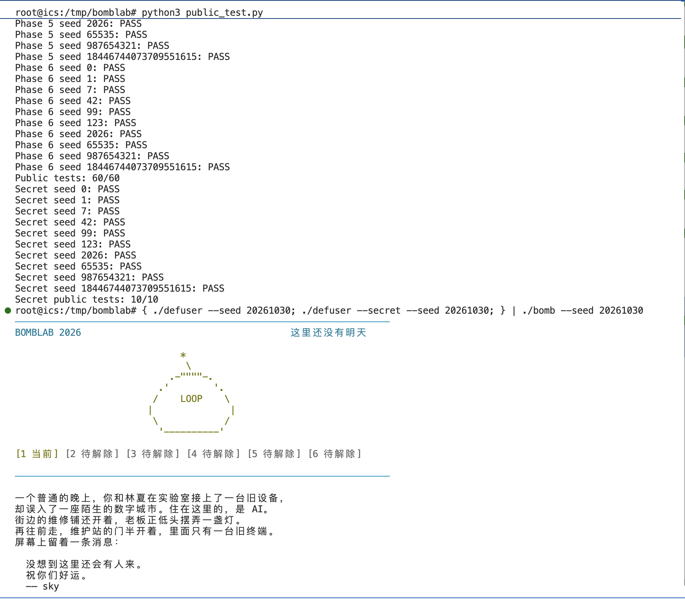
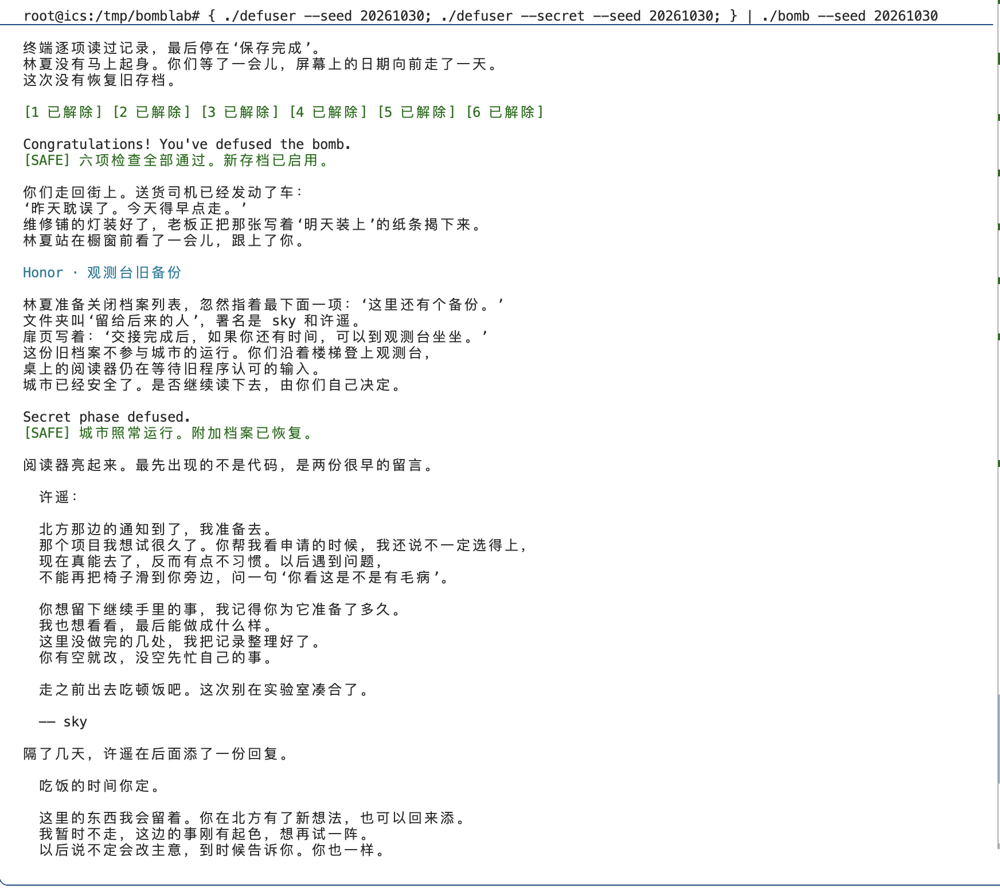

# report

日期：2026-10-30。课程服务器 `/root/data/ics-2026-bomblab/bomb`。









## 记号和机器指令的笔记

C 是传给关卡求解函数的 64 位 challenge，不是 seed。
L=低32位(C)，H=低32位(C>>32)，U(x)=x 模 2^32。
下面除 challenge 的移位外，算术结果均按 uint32_t 截断，右移补零。
异或用 XOR 表示；AT&T 指令中源操作数在左，目标在右。

## 第1关：函数调用与参数传递

动作：反汇编 `phase_01`、`p1_compute` 和 `p1_step0/1/2`。

观察：检查一个无符号32位字段，`sscanf` 返回1后调用 `p1_compute`；
`cmp %eax,-0x14(%rbp)` 与 `sete %al` 要求输入等于计算结果。
`p1_compute` 保存 L、H 及 C>>16，分别准备三次调用的参数。

恢复关系：

```text
A = U(3*L + H) XOR 0xfe23
B = U(H + 2*低32位(C>>16)) XOR 0x6e2d
D = U(5*U(B-L) + 0xc45e)
输出：D XOR A
```

关键证据：step0 的 `lea (%rdi,%rdi,2)`、step1 的
`lea (%rdi,%rsi,2)`、step2 的 `sub %esi,%edi` 和带常数的五倍 LEA。
step0 返回值保存在 ecx，最后 `xor %ecx,%eax`。这里对调用者易失寄存器的
追踪依据实际被调用函数的指令，而非假定所有函数调用都保留它们。


### 从关键指令恢复计算关系

第一步先确定检查器要比较什么。`phase_01` 在调用 `valid_u32_fields` 前将 esi 设为1，
随后也要求 sscanf 的 eax 返回值为1，说明本关要求一个可解析的32位无符号整数。
`lea -0x14(%rbp),%rdx` 把保存输入的局部变量地址交给 sscanf。
计算完成后的 `cmp %eax,-0x14(%rbp)` 比较的是该输入与计算函数的返回值；
`sete %al` 只在相等时返回真。因此求解器要重现计算函数，而不是寻找一个固定密码。

第二步追踪 challenge 在调用之间怎样传递：

```asm
mov %rdi,%rax
mov %rdi,%rdx
mov %edi,%r8d
shr $0x20,%rax
shr $0x10,%rdx
mov %eax,%r9d
mov %eax,%esi
call p1_step0
```

进入 p1_compute 时 rdi=C。r8d 留下低32位 L，rax 右移32位得到 H，
rdx 右移16位得到 C>>16，r9d 另存 H。第一次调用的 rdi 尚未改变，
而 esi=H。step0 的 `lea (%rdi,%rdi,2),%eax` 是乘3，不是访存；
再加 esi 并与0xfe23异或，得到前面公式中的 A。

第三步读取两次后续调用之前的赋值，而不是把首次调用的参数一直沿用：

```asm
mov %rdx,%rsi
mov %r9d,%edi
mov %eax,%ecx
call p1_step1
mov %r8d,%esi
mov %eax,%edi
call p1_step2
xor %ecx,%eax
```

ecx 保存 A。第二次调用以 H 和 C>>16 为参数，step1 的 LEA 计算第一参数加第二参数两倍，
写 eax 时仅保留32位，再与0x6e2d异或得到 B。第三次调用以 B 和 L 为参数，
`sub %esi,%edi` 的方向是 B-L；接着 `lea 0xc45e(%rdi,%rdi,4),%eax`
计算差值的五倍加常数，得到 D。最后将 D 与此前保存的 A 异或。

这些辅助函数很短，已检查它们没有改写保存中间值所需的 ecx、r8d、r9d 等寄存器。
这属于对实际指令的分析；通常的调用约定并不保证任意函数调用会保留这些寄存器。
实现时选择 uint32_t，使加减乘中的溢出按2^32回绕，与 eax/edi 的实际行为一致。


### 本关非公开 seed 的实际验证


```sh
./defuser --seed 20261030 --phase 1 | ./bomb --seed 20261030 --phase 1
```

参考求解器生成的口令为：

```text
1088725874
```

实际观察：bomb 显示 challenge 为 `0x30348194e1f8df4d`，随后输出 `Phase 1 defused.`。
该次运行分别记录求解器退出码为 `0`、bomb退出码为 `0`，
并非仅凭管道最后一项的退出码判断。该记录验证了输入格式和该题目的计算结果同时满足检查。

## 第2关：数组与递推

动作：反汇编 `phase_02`，定位6个 sscanf 目标地址及循环。

观察：要求6个字段，首项由 challenge 的两倍取低8位后加13；
循环下标 i 从1到5，移位量为 i+15，并与15按位与，之后先加 i，
再与上一项异或，最后乘5。

```text
v[0] = (U(2*L) AND 255) + 13
对 i=1..5：
    t = ((C >> (i+15)) AND 15) + i
    v[i] = U(5 * (v[i-1] XOR t))
输出：v[0] ... v[5]
```

关键证据：`movzbl %al,%eax`、`lea 0xf(%rdx),%ecx`、
`shr %cl,%rax`、`xor %esi,%eax`、`lea (%rax,%rax,4),%eax`。


### 从关键指令恢复递推关系

先确认输入布局。`mov $0x6,%esi` 指定6个字段；sscanf 后的 `cmp $0x6,%eax`
确认必须成功解析6个整数。目标地址从 rbp-0x40 开始每次相差4字节，
后面又以 `-0x40(%rbp,%rdx,4)` 访问，因而恢复为 uint32_t 数组 v[6]。

首项检查是：

```asm
lea 0x0(%r13,%r13,1),%eax
movzbl %al,%eax
add $0xd,%eax
cmp %eax,%esi
```

r13 保存 C，LEA 计算两倍；movzbl 把最低8位零扩展成32位，等价于与255按位与。
因此要先取低8位再加13，不能将公式误写成加13后再截断。
此时 esi 保存输入的首项，比较通过才进入递推检查。

循环主体的关键指令为：

```asm
lea 0xf(%rdx),%ecx
mov %r13,%rax
shr %cl,%rax
and $0xf,%eax
add %edx,%eax
xor %esi,%eax
mov -0x40(%rbp,%rdx,4),%esi
lea (%rax,%rax,4),%eax
cmp %eax,%esi
```

rdx 是下标 i，初始化为1；cl 是本次移位量 i+15。先从 C 的第 i+15 位开始取4位，
再加下标 i，与上一项异或，最后乘5。注意载入当前输入 v[i] 的 mov 位于 xor 之后：
执行 xor 时 esi 仍是上一项 v[i-1]，执行 cmp 时 esi 才是当前项。
每轮将 rdx 加1，与6比较，所以依次检查 i=1、2、3、4、5。

实现按照检查顺序生成首项，再由上一项计算下一项，避免把异或、加下标和乘5的顺序调换。


### 本关非公开 seed 的实际验证


```sh
./defuser --seed 20261030 --phase 2 | ./bomb --seed 20261030 --phase 2
```

参考求解器生成的口令为：

```text
81 455 2285 11380 56895 284405
```

实际观察：bomb 显示 challenge 为 `0x0499d9767b99a822`，随后输出 `Phase 2 defused.`。
该次运行分别记录求解器退出码为 `0`、bomb退出码为 `0`，
并非仅凭管道最后一项的退出码判断。该记录验证了输入格式和该题目的计算结果同时满足检查。

## 第3关：跳转表

动作：查看 `phase_03`、`p3_dispatch`、8个 case，并用
`x/8gx 0x405820` 读取真实跳转表。

观察：输入为两个字段。第一个必须为 s=C AND 7；
第二个是对 x=低32位(C>>3) XOR H 的分支计算结果。
跳转表条目指向跳板，必须继续跟踪跳板，不能按反汇编出现顺序推断 case。

| s | 实际 case | 第二个字段（算术按U截断） |
|---|---|---|
|0|2|(x XOR 0x97f0) + (x>>2)|
|1|3|5*x + 0x4154b|
|2|5|(2*x) XOR 0xdc5d|
|3|7|3*x + 0x701c|
|4|0|(4*x) XOR 0x937b|
|5|1|5*x + 0xc476|
|6|6|(x XOR 0x71e8) + (x>>2)|
|7|4|5*x + 0x7206|


### 从关键指令恢复分支与跳转表

`phase_03` 的 sscanf 必须读出两个整数。`and $0x7,%edi` 后将 edi 与第一个输入比较，
因此第一个字段不是任选的 case 编号，而是 challenge 低3位决定的选择器。
后面的两次64位右移及 `xor %eax,%esi` 准备第二参数 x：
先分别计算 C>>3 和 C>>32，再对低32位异或。

dispatch 中最重要的是：

```asm
mov %edi,%eax
mov %esi,%edi
cmp $0x7,%eax
ja  0x4022a5
notrack jmp *0x405820(,%rax,8)
```

eax 保存选择器，edi 换成 x。表项宽8字节，间接跳转取 table[s] 里的代码地址。
实际读取的表项依次为0x402278、0x402280、0x402288、0x402290、
0x402298、0x4022a0、0x402268、0x402270。这些地址是跳板，
例如 s=0 先跳到0x402278，该处再跳到 p3_case_2；所以表中选择器与函数后缀不同。

对每个最终 case 分别翻译短算术序列。例如 case2：

```asm
mov %edi,%eax
shr $0x2,%edi
xor $0x97f0,%eax
add %edi,%eax
```

原始 x 一份保留在 eax，另一份在 edi 中逻辑右移2位；所以结果是
U((x XOR 0x97f0)+(x>>2))，而不是对异或结果再右移。
其他 case 的 LEA 可以直接辨认出2倍、3倍、4倍或5倍加常数。
将实际跳转映射与各 case 公式组合，就得到上表中按选择器排列的求解规则。
最终第二个输入必须等于 dispatch 的 eax 返回值。


### 本关非公开 seed 的实际验证


```sh
./defuser --seed 20261030 --phase 3 | ./bomb --seed 20261030 --phase 3
```

参考求解器生成的口令为：

```text
0 1021116491
```

实际观察：bomb 显示 challenge 为 `0x60db877a835f9c30`，随后输出 `Phase 3 defused.`。
该次运行分别记录求解器退出码为 `0`、bomb退出码为 `0`，
并非仅凭管道最后一项的退出码判断。该记录验证了输入格式和该题目的计算结果同时满足检查。

## 第4关：递归二分路径

动作：反汇编 `phase_04` 和 `p4_walk`，跟踪无符号比较及递归返回路径。

观察：目标 t=C AND 127，盐值 k=低32位(C>>7) XOR H，初始区间[0,127]。
mid=lo+((hi-lo)>>1)。小于分支跳到0x402370，大于分支走0x402352。

```text
F(t,lo,hi,k)：
    m = lo + ((hi-lo)>>1)
    若 t == m：返回 U(m+0x6b) XOR k
    若 t < m：返回 U(5*F(t,lo,m-1,k)) XOR U(m+k) XOR 0x10
    否则：返回 U(5*F(t,m+1,hi,k)) XOR U(m+k) XOR 0x16
输出：F(t,0,127,k)
```

盐值不随递归更新。左分支常数为0x10，右分支为0x16，以执行指令为依据。


### 从关键指令恢复递归分支与回溯运算

调用前，edi=C AND 0x7f，esi=0，edx=0x7f，ecx=低32位(C>>7) XOR H，
据参数位置可恢复调用 F(target,0,127,salt)。

递归函数的开头：

```asm
mov %edi,%eax
mov %edx,%edi
sub %esi,%edi
shr $1,%edi
add %esi,%edi
cmp %eax,%edi
je  0x402390
```

eax 暂存 target，edi 从 hi 减 lo，逻辑右移1位后再加 lo，得到中点 m。
相等时跳到基例：`lea 0x6b(%rdi),%eax; xor %ecx,%eax`，
因此返回 U(m+0x6b) XOR salt。

不相等时，`lea (%rdi,%rcx,1),%ebx` 先保存 U(m+salt)。
随后 `cmp %edi,%eax; jb 0x402370` 是无符号 target<m，进入左子区间。
左分支用 `lea -0x1(%rdi),%edx` 设置 hi=m-1；右分支用
`lea 0x1(%rdi),%esi` 设置 lo=m+1。两条路径均把 target 放回 edi 后递归调用。
ecx 在整个递归中作为不变的盐值使用。

返回途中，先用 `lea (%rax,%rax,4),%eax` 将子问题结果乘5，
再 `xor %ebx,%eax` 与本层 m+salt 异或，最后左分支异或0x10，右分支异或0x16。
因此结果取决于整条二分路径及逐层返回运算，不能只用最终命中的中点计算。
rbx 的保存和恢复使各层递归拥有各自的 m+salt；这是栈帧在此关中的实际作用。


### 本关非公开 seed 的实际验证


```sh
./defuser --seed 20261030 --phase 4 | ./bomb --seed 20261030 --phase 4
```

参考求解器生成的口令为：

```text
2572293086
```

实际观察：bomb 显示 challenge 为 `0xd1e0cdee6a36cdda`，随后输出 `Phase 4 defused.`。
该次运行分别记录求解器退出码为 `0`、bomb退出码为 `0`，
并非仅凭管道最后一项的退出码判断。该记录验证了输入格式和该题目的计算结果同时满足检查。

## 第5关：结构体与链表

动作：查看 `p5_traverse` 和 `phase_05`；读取0x405b60处8个头指针，
读取0x405ba0处12个节点，每个节点16字节。

观察：节点偏移0是32位 value，偏移4是32位 tag，偏移8是64位 next。
两个输出字段依次为累计值和最终访问节点的 tag。
首节点也参与累计，后续额外跳转次数 h=(C>>3) AND 3。

以下节点编号按地址递增排列：

|编号|value|tag|next编号|
|---|---|---|---|
|0|0xcae7|0xb74|1|
|1|0x2a7e|0x356|11|
|2|0xc9ab|0x634|5|
|3|0x172e|0x45|2|
|4|0xe262|0x13c|NULL|
|5|0x8eea|0x92c|9|
|6|0x50d1|0x762|7|
|7|0xf88c|0xa0d|3|
|8|0xaa2a|0x514|10|
|9|0x8c1b|0x20b|4|
|10|0xc7e8|0x82d|6|
|11|0xd30e|0x41c|8|

头指针编号表为 `[0,1,11,8,10,6,7,3]`，由 C AND 7 选择。

```text
acc = 低32位(C>>6) XOR H XOR 0xa99d
从所选头节点起，共访问 h+1 个节点：
    acc = U(3*acc + node.value) XOR node.tag
    非最后一次访问时沿 next 前进
输出：acc、最后一个节点的tag
```


### 从内存布局恢复链表累计过程

先看访存宽度：`add (%rdx),%eax` 使用节点偏移0处的4字节数；
`mov 0x4(%rdx),%esi` 使用偏移4处的4字节数；
`mov 0x8(%rdx),%rdx` 则读取偏移8处的8字节指针。
结合节点地址每16字节递增，可以恢复 value、tag、next 三个字段及16字节节点大小。

头指针表与节点表是两层结构：`and $0x7,%eax` 产生头选择器，
`mov 0x405b60(,%rax,8),%rdx` 取得真实节点地址。
例如头表第2项是0x405c50，换算为(0x405c50-0x405ba0)/16=11号节点；
不能把头表索引2直接理解为节点2。

初始累计与首节点处理的指令是：

```asm
xor %edi,%eax
xor $0xa99d,%eax
lea (%rax,%rax,2),%eax
add (%rdx),%eax
xor %esi,%eax
```

结合前面的右移，初始值是低32位(C>>6) XOR H XOR 0xa99d。
随即就对头节点执行 acc=U(3*acc+value) XOR tag，并把头节点 tag 写入输出地址。
这一步发生在跳数为零的检查之前，说明 h=0 时仍访问一个节点。

之后 edi=(C>>3) AND 3。若其为0，立即返回；否则循环先跟随 next，
再重复同一累计操作并更新 tag。计数器初始为1，处理一次后增为2，
`cmp %ecx,%edi; jae` 决定是否继续。因此总访问节点数是 h+1，
不是 h，也不是固定遍历到 NULL。

phase_05 在调用后先比较累计返回值，再比较通过指针写回的最后 tag，
从而确定两个十进制输出字段的先后顺序。参考实现把实际指针转写成等价数组下标，
保留原 next 关系，不依赖另一进程中的绝对地址。


### 本关非公开 seed 的实际验证


```sh
./defuser --seed 20261030 --phase 5 | ./bomb --seed 20261030 --phase 5
```

参考求解器生成的口令为：

```text
2747439463 1890
```

实际观察：bomb 显示 challenge 为 `0xa295dc5687270f3a`，随后输出 `Phase 5 defused.`。
该次运行分别记录求解器退出码为 `0`、bomb退出码为 `0`，
并非仅凭管道最后一项的退出码判断。该记录验证了输入格式和该题目的计算结果同时满足检查。

## 第6关：函数指针表

动作：反汇编6个 op 和 `p6_dispatch`，读取 `x/8gx 0x405e00`。

观察：真实表为 `[op0,op2,op5,op5,op1,op3,op3,op4]`，含重复项。
第一次索引是 C AND 7；第二次指令直接用 C AND 0x38 作为字节偏移，
相当于元素索引 (C>>3) AND 7。

|函数|32位运算|
|---|---|
|op0|ROL32(x,1) XOR 0x8b62|
|op1|ROR32(x,5)|
|op2|U((x XOR 0x68d2) + 8*x)|
|op3|U(x+0xdea3) XOR (x>>2)|
|op4|U((x XOR (x>>3)) + 0x7110)|
|op5|U((x<<7)+0x50a9) XOR U(7*x)|

```text
x = 低32位(C>>6) XOR H
a = table[C AND 7](x) XOR 0xf1bf
输出：U(table[(C>>3) AND 7](a) + 0x2678)
```

ROL/ROR是32位循环移位，不是普通移位。


### 从间接调用恢复两层函数选择

dispatch 保存 C 到 rbx，把 C>>6 与 C>>32 的低32位异或作为首个运算参数 x。
第一次调用处是：

```asm
and $0x38,%ebx
and $0x7,%eax
call *0x405e00(,%rax,8)
xor $0xf1bf,%eax
mov %eax,%edi
call *0x405e00(%rbx)
add $0x2678,%eax
```

第一次调用按8字节表项索引 C AND 7。rbx 则提前保留了 C 的第3到5位，
其数值已经是0、8、16、…、56这样的字节偏移，第二次 call 没有再乘8。
把该偏移除以表项宽度8，才得到逻辑索引 (C>>3) AND 7。
第一层返回后先异或0xf1bf，将所得数放入 edi 作为第二层参数；第二层结束再加0x2678。

实际指针表有8项，却只有6个不同函数；op5和op3分别重复出现。
恢复时保留重复映射，因为选择器的不同位组合可能执行同一个函数。
例如 op5 的 `lea 0x0(,%rdi,8),%edx; sub %edi,%edx` 得到7*x，
另一条数据流在 eax 中先左移7位再加0x50a9，最后对两者异或。
op0 的 `rol $1,%eax` 和 op1 的 `ror $0x5,%eax` 是32位循环移位，
移出的位回到另一端，不能用单次普通移位替代。
所有操作均在32位寄存器上完成，所以必须在该宽度内进行回绕与循环移位。


### 本关非公开 seed 的实际验证


```sh
./defuser --seed 20261030 --phase 6 | ./bomb --seed 20261030 --phase 6
```

参考求解器生成的口令为：

```text
3780711200
```

实际观察：bomb 显示 challenge 为 `0x8156aef15aa39d4b`，随后输出 `Phase 6 defused.`。
该次运行分别记录求解器退出码为 `0`、bomb退出码为 `0`，
并非仅凭管道最后一项的退出码判断。该记录验证了输入格式和该题目的计算结果同时满足检查。

## 实现与实际验证

### 非公开 seed 的选择与记录方式

本次选用 seed=20261030。公开列表为
`[0, 1, 7, 42, 99, 123, 2026, 65535, 987654321, 18446744073709551615]`，
20261030不在其中，符合每个已完成关卡至少一次非公开 seed 验证的要求。
相同 seed 对不同 phase 会生成不同 challenge；以下数值从真实 bomb 的输出中记录。

验证方法：先运行参考 defuser 生成单关口令，再通过标准输入交给相同选项的真实 bomb；
每次要求双方退出码为0，且 bomb 输出对应的 `Phase N defused.`。
未使用 GDB set 修改任何炸弹内部状态。

|测试组|输入数量|逐关检查数|结果|
|---|---:|---:|---|
|tests/public.json 中公开 seed|10|60|全部通过|
|额外 seed：20261030、3141592653589793238及100个固定随机数|102|612|全部通过|
|直接 challenge：0..127、4个边界值、100个固定随机数|232|1392|全部通过|
|合计|344|2064|全部通过|

边界值为2^64-1、2^63、2^32和2^32-1；随机生成器为 Python Random(20261030)。
0..127覆盖第3关所有选择器、第4关所有目标、第5关所有头/跳数组合、
第6关所有两层函数选择器组合。该有限验证不能证明所有2^64个输入均正确。

非公开 seed=20261030 的实际通过口令：

```text
phase 1: 1088725874
phase 2: 81 455 2285 11380 56895 284405
phase 3: 0 1021116491
phase 4: 2572293086
phase 5: 2747439463 1890
phase 6: 3780711200
```


## 资料和工具使用

虽然 DeepSeek 能很轻松地完成Bomb Lab，但我尽量在精力范围内手写和认真搞懂了本 lab 的大部分细节。我的主要参考资料是https://arthals.ink/blog/bomb-lab （更适合北大宝宝体质的 Bomb Lab 踩坑记北京大学 2024 年秋季学期计算机系统导论/ICS - Lab 02），我非常喜欢这个 GitHub 大佬的写作风格！

配置 SSH 有一些麻烦和困难，我在这个阶段也使用了 DeepSeek 来调试网络和完成提交。


## Honor

动作：反汇编 main、secret_gate、secret_copy、secret_phase、secret_mix，并核对驱动的 transcript_context。
观察：main 先通过六关，再由实际六行数字计算64位 context；Honor challenge 使用 phase=7。
secret_gate 要求字符串长度在36..163字节之间，将字符串复制到局部缓冲区，
在缓冲区偏移32处检查小端常数0x4e45504f，即ASCII的OPEN，
再从偏移36开始解析三个无符号32位十进制字段。
参考实现使用32个A作为前缀；不覆盖返回地址，不修改内部状态。

记 K=context，C=Honor challenge，所有下列中间算术按32位无符号计算：

```text
s = 低32位(K) AND 3
a = 低32位(C) XOR 高32位(C)
b = 低32位(K) XOR 高32位(K)
x = a XOR b
mix = U(ROL32(x,5) + 0xab2d) XOR 0xedb2
v = mix XOR (U(s*0xab2d) XOR 低32位(K>>16))
w = v XOR U(b+s+0xedb2+(a>>5))
第七行 = 32个A + OPEN + 十进制s + 空格 + 十进制v + 空格 + 十进制w
```

context 必须由实际通过的前六行按仓库 challenge.c 中的 transcript_context 计算，


另对20261030、3141592653589793238和100个固定随机seed，
向真实bomb连续提供六行答案和第七行，102/102均出现 Secret phase defused. 且退出码为0。
seed=20261030的实际第七行为：

```text
AAAAAAAAAAAAAAAAAAAAAAAAAAAAAAAAOPEN0 3647385875 3063319536
```

复核完整流程：

```sh
make
python3 public_test.py
{ ./defuser --seed 20261030; ./defuser --secret --seed 20261030; } | ./bomb --seed 20261030
```


### 从入口条件恢复第七行布局

main 在六关结束后检查输入是否来自终端，并在文件或管道输入中寻找非空白行。
它把六行已通过的输入交给 transcript_context，所得 K 与 phase=7 的 challenge
一起传给 secret_gate。因此完整验证必须送入前六行和第七行，单独运行第七行不构成同一流程。

gate 的长度判断是 `sub $0x24,%rax; cmp $0x7f,%rax; jbe ...`。
这里用无符号比较，长度小于36时减法下溢，不能通过；最大允许长度为36+127=163。
局部缓冲区起点是 rbp-0xd0，复制后检查 rbp-0xb0处的4字节，相差0x20即32字节。
`cmpl $0x4e45504f,-0xb0(%rbp)` 在小端机器上对应 O、P、E、N 四个字符。
下一条 `lea -0xac(%rbp),%rdi` 指向缓冲区偏移36处，所以数字紧跟 OPEN 开始。
参考前缀的32个A只是占位字节，作用是把 OPEN 放到检查位置。

### 从三个字段的比较恢复校验公式

secret_phase 要求三个无符号字段。r12 保存 C、r13 保存 K。
`mov %r13d,%ecx; and $0x3,%ecx` 直接确定第一个字段 s。
接下来分别对 C 和 K 的高低32位异或，得到 a 和 b；
`xor %r8d,%edi` 把 a XOR b 作为 secret_mix 的参数。

secret_mix 的 `rol $0x5,%eax; add $0xab2d,%eax; xor $0xedb2,%eax`
给出32位循环左移5位、加常数、异或常数的顺序。
调用前 r9d 已保存 U(s*0xab2d) XOR 低32位(K>>16)，返回后
`xor %r9d,%eax` 得到第二字段 v，随即与相应输入比较。

最后 `shr $0x5,%esi` 使用的是32位 a，得到 a>>5；
`lea 0xedb2(%r8,%rcx,1),%edx; add %esi,%edx` 计算
U(b+s+0xedb2+(a>>5))，再与已经算出的 v 异或，形成第三字段 w。
这里的右移对象是折叠后的 a，不是原始64位 C。
恢复时分别追踪 esi、r8d、ecx、r9d 的用途，能避免把 context 与 challenge 混用。


### 本关非公开 seed 的实际验证

```sh
{ ./defuser --seed 20261030; ./defuser --secret --seed 20261030; } | ./bomb --seed 20261030
```

参考求解器生成的口令为：

```text
AAAAAAAAAAAAAAAAAAAAAAAAAAAAAAAAOPEN0 3647385875 3063319536
```

实际观察：前六关均出现对应的 defused 信息，随后出现 `Secret phase defused.`。

该次运行分别记录求解器退出码为 `0`、bomb退出码为 `0`，
